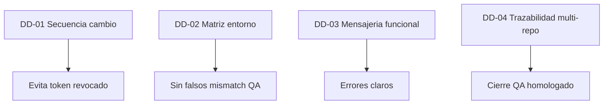

# Decisiones de Diseno

## Leyenda de siglas
- `FE`: Frontend.
- `BE`: Backend.
- `QA`: Quality Assurance (control de calidad).
- `DEV`: Entorno de desarrollo.
- `E2E`: End-to-End (prueba de extremo a extremo).
- `TR`: Trazabilidad de requerimientos.
- `DD`: Decision de diseno.

## Trazabilidad de decisiones

## DD-01 Secuencia obligatoria en cambio de contrasena
Decision:
- Ejecutar popup de cambio antes del destino final y asegurar sesion valida despues del cambio.

Motivo:
- Evitar continuidad con token revocado.

Impacto:
- Flujo estable y coherente con seguridad backend.

## DD-02 Validacion de entorno por matriz
Decision:
- Reemplazar regla rigida de igualdad de hosts por matriz contextual DEV/QA/LOCAL/PROD.

Motivo:
- QA split-host es valido por arquitectura.

Impacto:
- Se eliminan falsos positivos de mismatch.

## DD-03 Mensajeria funcional prioritaria
Decision:
- Mostrar texto funcional de backend cuando este disponible.

Motivo:
- Facilitar soporte funcional y validacion QA.

Impacto:
- Menor ambiguedad en errores.

## DD-04 Trazabilidad multi-repo
Decision:
- Mantener trazabilidad FE-BE para LOGIN y satelites.

Motivo:
- Evitar derivas entre implementaciones.

Impacto:
- Cierre de pase QA con evidencia homologada.
